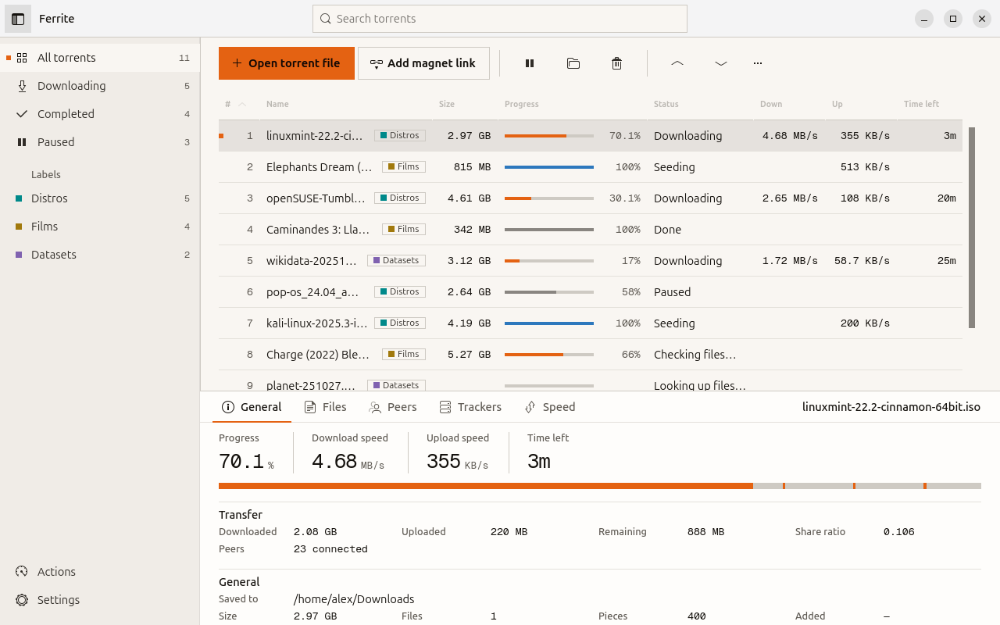
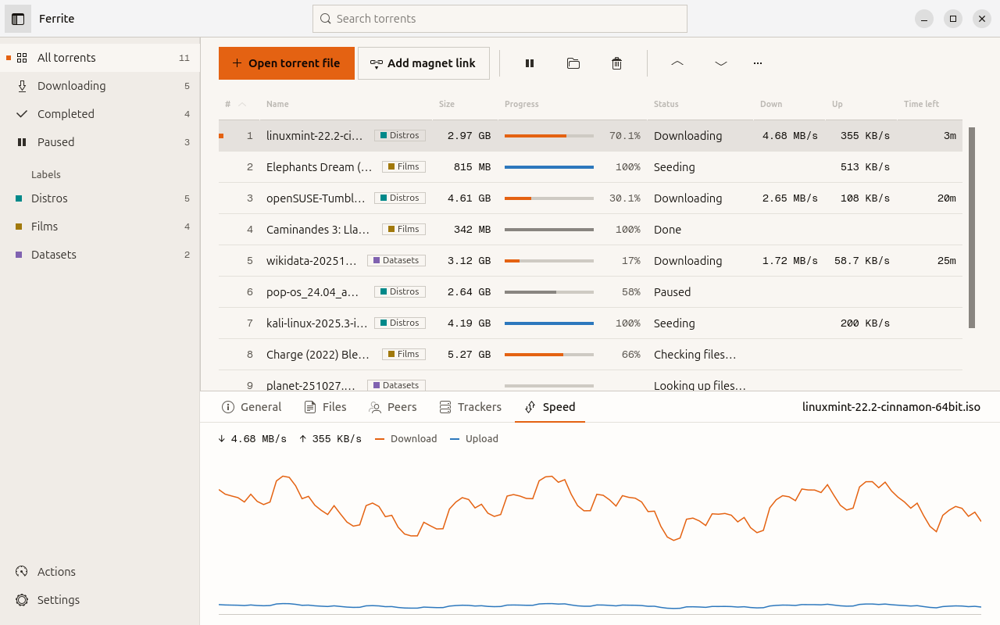
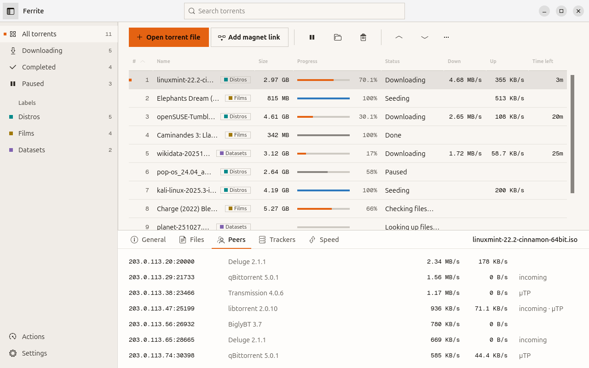
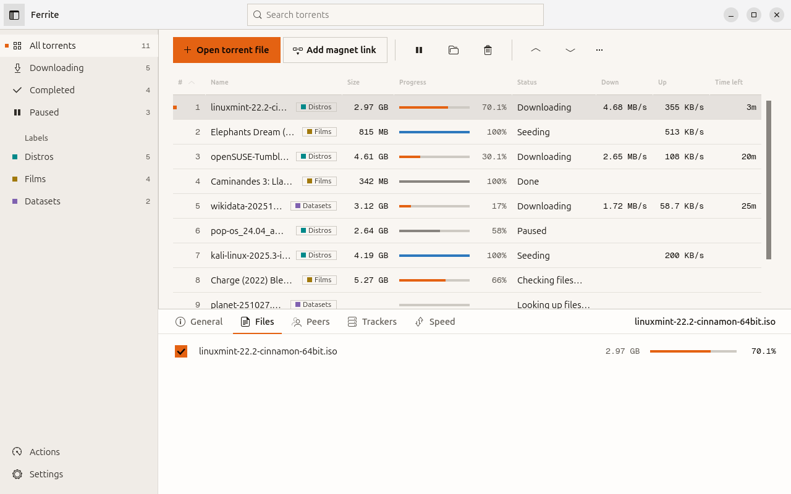
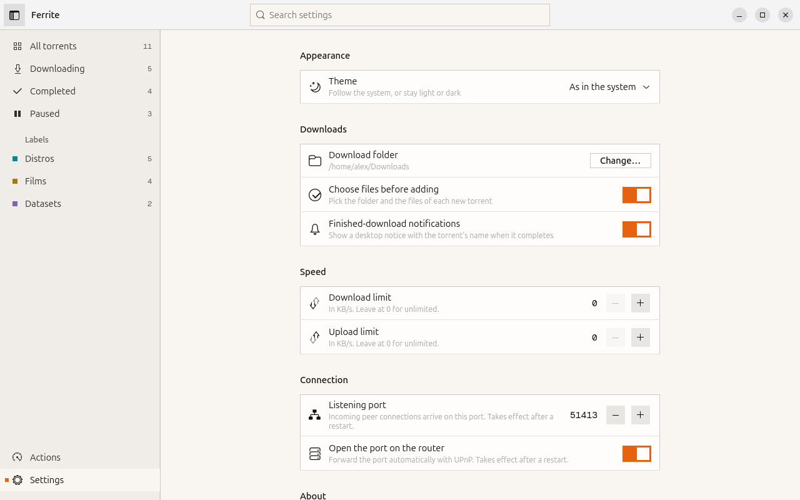
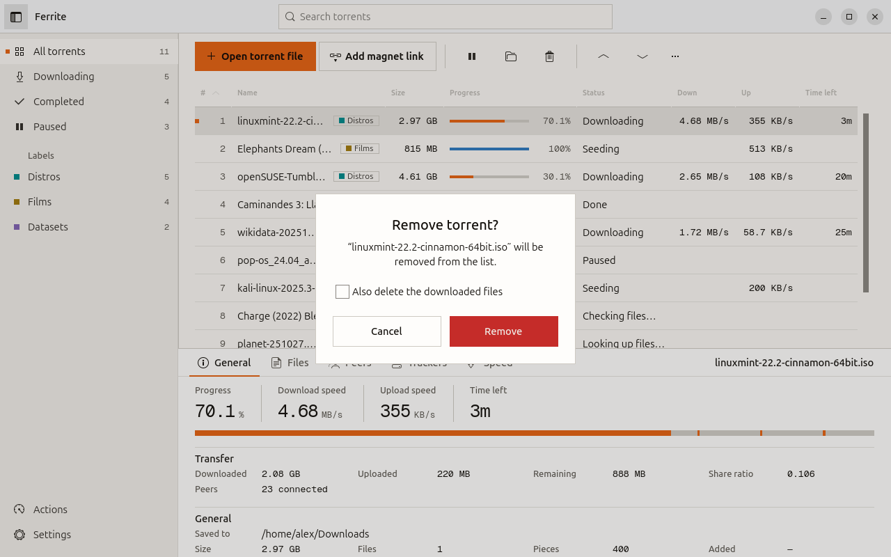
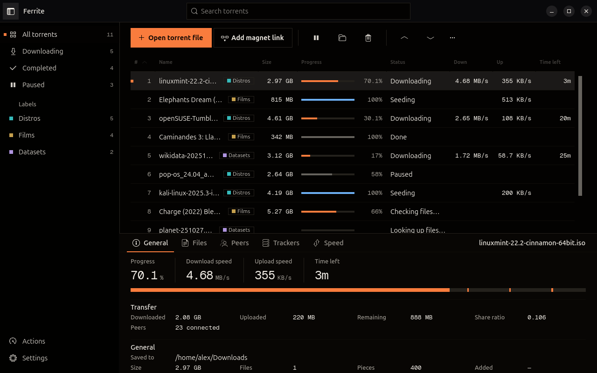

# Ferrite

A precise BitTorrent client for Linux, written entirely in Rust.

<picture>
  <source media="(prefers-color-scheme: dark)" srcset="docs/screenshots/torrents-dark.png">
  
</picture>

Ferrite downloads and seeds torrents in an interface built like an instrument: square edges, hairlines instead of
boxes, every measurement — sizes, speeds, time left, peers — set in Geist Mono, and colour that only ever means
state. **Your desktop's accent colour** marks downloading, the main action and your current selection; a second
colour marks seeding and upload (sky-blue, or green when your accent is blue-ish so the two never match); **grey**
is paused, **red** is an error, and every colour comes with a status word. Without a desktop accent, Ferrite uses its
own orange — as in these pictures.

- **Interface:** GTK 4 + libadwaita, through [gtk4-rs](https://gtk-rs.org)
- **Engine:** [librqbit](https://github.com/ikatson/rqbit), a BitTorrent engine written in Rust: DHT, trackers,
  µTP, UPnP, fast resume
- **No ads, no telemetry, no account.** Apache-2.0.

## A closer look

<table>
  <tr>
    <td width="50%">
      <picture>
        <source media="(prefers-color-scheme: dark)" srcset="docs/screenshots/speed-dark.png">
        
      </picture>
      <p><b>Speed</b> — the last two minutes, download in the accent colour, upload in the second.</p>
    </td>
    <td width="50%">
      <picture>
        <source media="(prefers-color-scheme: dark)" srcset="docs/screenshots/peers-dark.png">
        
      </picture>
      <p><b>Peers</b> — who you are trading with, their client and speeds.</p>
    </td>
  </tr>
  <tr>
    <td width="50%">
      <picture>
        <source media="(prefers-color-scheme: dark)" srcset="docs/screenshots/files-dark.png">
        
      </picture>
      <p><b>Files</b> — tick off the files you don't want, even mid-download.</p>
    </td>
    <td width="50%">
      <picture>
        <source media="(prefers-color-scheme: dark)" srcset="docs/screenshots/settings-dark.png">
        
      </picture>
      <p><b>Settings</b> — one page, searchable from the title bar.</p>
    </td>
  </tr>
  <tr>
    <td width="50%">
      <picture>
        <source media="(prefers-color-scheme: dark)" srcset="docs/screenshots/remove-dark.png">
        
      </picture>
      <p><b>Remove</b> — always names what goes, and asks before deleting files.</p>
    </td>
    <td width="50%">
      <picture>
        <source media="(prefers-color-scheme: dark)" srcset="docs/screenshots/torrents-light.png">
        
      </picture>
      <p><b>Both themes</b> — warm black or warm paper; follows the system or your choice.</p>
    </td>
  </tr>
</table>

<sub>Pictures come from `ferrite --demo`: open-licensed distros, Blender Studio films and public datasets with
simulated transfers, no network.</sub>

## What it does

- **Add torrents** from `.torrent` files, magnet links (picked up from the clipboard), drag and drop, or straight
  from the file manager and the browser
- **Choose before you add:** the folder and the files, with a warning when they won't fit on the drive
- **A ruled table** with sortable, resizable columns; right-click a header to choose them; your own order (#)
- **Views and labels** in the side pane — All, Downloading, Completed, Paused, and coloured labels — each with a count
- **Search** from the title bar (Ctrl+F): every word, any order, ignoring case and accents
- **The details band:** the selected torrent's progress, speeds and time left set large, a piece strip, transfer
  facts, files, peers, trackers and the speed graph
- **Work on many at once:** pause, resume, label, reorder or remove a selection; a right-click menu on every row
- **Limits and networking:** global download and upload limits, listening port, UPnP
- **Problems in plain words** — "Disk is full — make room, then resume" — and fixed by resuming
- **Notifications** when a download completes
- **Picks up where it left off** after a restart; paused torrents stay paused

## Install

Ferrite is packaged for Debian and Ubuntu. Build the package (see below) and install it:

```sh
sudo apt install ./target/debian/ferrite_*.deb
```

It appears in your app menu and offers to open `.torrent` files and `magnet:` links. To make it the default for
both:

```sh
xdg-mime default io.github.ferrite.Ferrite.desktop application/x-bittorrent x-scheme-handler/magnet
```

## Build

Needs Rust 1.88+ and the GTK 4 / libadwaita development files:

```sh
sudo apt install libgtk-4-dev libadwaita-1-dev
cargo run --release
```

The Debian package:

```sh
cargo install cargo-deb   # once
cargo deb
```

`cargo test` runs the unit tests and an offline round trip through the real engine: create a torrent, add it,
verify it, pause, resume, remove.

## Keyboard

| Keys | Action |
|---|---|
| Ctrl+O | Open torrent file |
| Ctrl+N | Add magnet link |
| Ctrl+F | Search |
| Delete | Remove the selected torrents |
| Alt+↑ / Alt+↓ | Move up / down in the order |
| Ctrl+A / Esc | Select all / clear the selection |
| Ctrl+, | Settings |
| Ctrl+Q | Quit |

## Demo and screenshots

`ferrite --demo` opens the sample torrents shown above, with simulated transfers and no network. It runs beside a
normal instance and never touches your settings. To render a picture:

```sh
FERRITE_SCREENSHOT=out.png FERRITE_THEME=dark FERRITE_TAB=peers cargo run -- --demo
```

`FERRITE_TAB` is `general`, `files`, `peers`, `trackers` or `speed`; `FERRITE_PAGE=settings` opens Settings,
`FERRITE_ACTION=win.remove` opens the remove dialog, and `FERRITE_ACCENT=ferrite` uses Ferrite's orange instead of the
desktop accent (as the pictures here do).

## Where things live

| What | Where |
|---|---|
| Settings, labels, order | `~/.config/ferrite/settings.json` |
| Engine resume data | `~/.local/share/ferrite/session/` |
| Downloads | `~/Downloads` (change in Settings) |

## Code

| File | Role |
|---|---|
| `src/engine.rs` | librqbit wrapper and the demo engine; plain snapshots for the UI |
| `src/item.rs` | One table row as a GObject the cells bind to |
| `src/ui/window.rs` | Window, side pane, toolbar, table, refresh loop, commands |
| `src/ui/details.rs` | The details band and its tabs |
| `src/ui/widgets.rs` | Piece strip and speed graph (Cairo, coloured from CSS) |
| `src/ui/dialogs.rs` | Add, magnet, remove, new label |
| `src/ui/settings.rs` | Settings page |
| `src/style.css` | The look: libadwaita mapped onto the tokens, then each region |
| `src/palette-dark.css`, `src/palette-light.css` | The tokens (OKLCH): paper, ink, rules, the two signals, label tones |
| `data/fonts/` | Geist Mono, bundled into the binary and registered at startup |

## Roadmap

A download queue (a few at a time), per-torrent speed limits, play while downloading, shut down or sleep after
downloads finish, keep seeding in the background with the window closed, translations, Flatpak. The full plan is in
the [product requirements](docs/PRD.md).

## Credits

Geist Mono © 2024 The Geist Project Authors, under the SIL Open Font License 1.1 (`data/fonts/OFL.txt`).

## License

[Apache-2.0](LICENSE).
